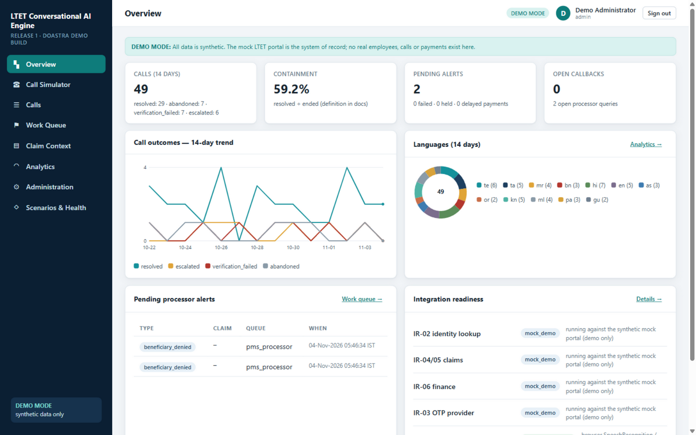
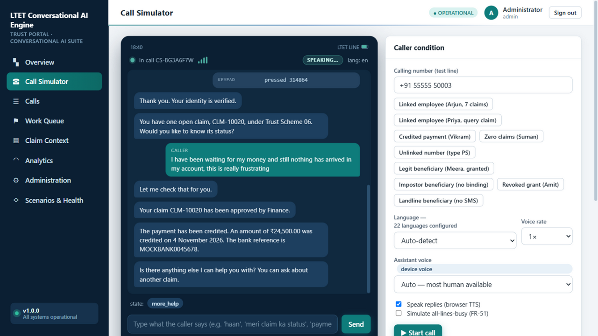

<p align="center">
  
</p>

<h1 align="center">
  🎙️ LTET Conversational AI Engine
</h1>

<p align="center">
  <strong>A deterministic, fact-safe conversational AI platform for the LTET Employee Trust Portal</strong>
</p>

<p align="center">
  <em>Voice assistant that answers verified claim-status, payment &amp; beneficiary enquiries<br/>across 22 languages — then produces auditable post-call intelligence for processors.</em>
</p>

<p align="center">
  <a href="#-quickstart"></a>
  <a href="docs/DEMO_GUIDE.md"></a>
  <a href="docs/ARCHITECTURE.md"></a>
</p>

<p align="center">
  
  
  
  
  
  
  
</p>

<br/>

---

<br/>

## 🌟 What Is This?

The **LTET Conversational AI Engine** is a complete **Release 1.0** platform — backend, frontend, durable worker, tests, and governed administration — built by **DOASTRA** for the LTET Employee Trust Portal.

It's not an IVR. It's not a chatbot. It's a **deterministic voice agent** that:

- 🎤 **Listens continuously** with endpointed live voice (or accepts keypad/text)
- 🧠 **Understands free-form multi-clause speech** including frustration, urgency, and code-switching
- 🔍 **Runs an exhaustive resolution search** against live portal data before every answer
- ✅ **Validates every spoken fact** against a fresh source snapshot — nothing invented, nothing unverified
- 🤝 **Transfers to humans only when no automated path resolves the issue** — carrying full context so the caller never repeats themselves

<br/>

<p align="center">
  
</p>

<br/>

---

## ⚡ Beyond IVR — Why This Is an Agent, Not a Menu

<table>
<tr>
<th width="30%">Feature</th>
<th width="35%">Traditional IVR 📞</th>
<th width="35%">LTET AI Engine 🎙️</th>
</tr>
<tr>
<td><strong>Input method</strong></td>
<td>Keypad DTMF or strict single-word commands</td>
<td>Natural spoken voice (live mic with endpointing) & keypad fallback</td>
</tr>
<tr>
<td><strong>Language support</strong></td>
<td>Fixed menu, single language per call</td>
<td>22 languages with live code-switching mid-sentence</td>
</tr>
<tr>
<td><strong>Data fetching</strong></td>
<td>Static audio prompts / basic lookups</td>
<td>Live real-time portal queries at answer time</td>
</tr>
<tr>
<td><strong>Problem handling</strong></td>
<td>Rigid menu trees, dead ends</td>
<td>Exhaustive resolution search over every resolvable path before human transfer</td>
</tr>
<tr>
<td><strong>Call outcome</strong></td>
<td>Simple routing or static readout</td>
<td>Structured post-call summary, sentiment estimate & processor alerts</td>
</tr>
<tr>
<td><strong>Factual safety</strong></td>
<td>Depends on fixed hardcoding</td>
<td>Real-time fact validator guardrail before TTS</td>
</tr>
</table>

<br/>

---

## 🎯 Use Cases (Release 1)

<table>
<tr>
<td width="33%" align="center">

### 📋 UC-01: Claim Status

17 configurable schemes • 4 processing stages • zero/one/many claims • latest-three narration with batches • open processor queries read aloud • five-claims-per-call cap

</td>
<td width="33%" align="center">

### 💰 UC-02: Payment Info

Finance approval stated first • payment group mapping (credited / processed / pending / failed / held) • authoritative amounts & bank refs • dispute escalation • no cached answers for unavailable data

</td>
<td width="33%" align="center">

### 👥 UC-03: Beneficiaries

Employee vs. beneficiary branching • PS-No digit-by-digit capture • challenge to calling number • **least-privilege via trusted binding + explicit grant**

</td>
</tr>
</table>

<br/>

---

## 🚀 Quickstart

> **Prerequisites:** Node.js ≥ 22.13 (uses built-in `node:sqlite`). No native deps. No API keys.

```bash
# Clone the repository
git clone https://github.com/Siddhant-Pardeshi-Doastra/ltet-conversational-ai-engine.git
cd ltet-conversational-ai-engine

# Install dependencies (~5 seconds, pure JS)
npm install

# Seed the workspace dataset (17 schemes, 14 employees, 24 claims)
npm run seed

# Launch the platform
npm start
# → http://127.0.0.1:8787
```

Or in **one step**: `npm run demo` (reset + start)

<br/>

### 🔑 Workspace Accounts

> All accounts use password: `Demo#Pass1`

| User | Role | Access |
|:---:|:---:|:---|
| `pms1`, `pms2` | PMS Processor | PMS-stage alerts, claim context in stage |
| `spm1` | Sub-Panel Member | Sub-panel Review queue |
| `apm1` | Apex Panel Member | Apex Panel Review + Approval queue |
| `admin1` | Administrator | **Everything** incl. administration + workspace tools |
| `auditor1` | Auditor | Read-only incl. transcripts (FR-36) |

> 💡 **Quick demo:** Sign in as `admin1`, open **Call Simulator**, click a caller preset (e.g. *"Credited payment (Vikram)"*), follow the guided flow, read the OTP from the **Secure Message Inbox** panel.

<br/>

---

## 🏗️ Architecture

```
                         ┌────────────────────────────────────────────────┐
   Staff Console         │  public/ SPA (Overview, Simulator, Calls,      │
   (browser) ───────────►│  Queue, Claim Context, Analytics, Admin,      │
                         │  Scenarios & Health)                           │
                         └───────────────┬────────────────────────────────┘
                                         │ fetch (session cookie)
                         ┌───────────────▼────────────────────────────────┐
   Carrier/IVR (live)    │  Express API (server/routes)                   │
   webhook ─────────────►│  auth · calls · staff · admin · demo · health  │
   (HMAC + nonce)        │────────────────────────────────────────────────│
                         │  Conversation Engine (server/engine)           │
                         │   machine.js  — deterministic state machine    │
                         │   conversation.js — free-form understanding    │
                         │   resolution.js — exhaustive resolution search │
                         │   intents.js  — no-key NLU (22 languages)      │
                         │   answers.js  — fact-safe plans + validation   │
                         │────────────────────────────────────────────────│
                         │  Adapters (server/adapters)                    │
                         │   portal.js  ·  otp.js  ·  speech.js          │
                         │────────────────────────────────────────────────│
                         │  Services                                      │
                         │   calls · verification · alerts · policy       │
                         │   postcall (durable worker) · analytics        │
                         │   retention · audit · scenarios                 │
                         └───────────────┬────────────────────────────────┘
                                         │ node:sqlite (WAL)
                         ┌───────────────▼────────────────────────────────┐
                         │  data/ltet.db                                  │
                         │  portal_* (synthetic system of record)         │
                         │  call_* / alerts / jobs / audit / policy_cfgs  │
                         └────────────────────────────────────────────────┘
```

<details>
<summary><strong>📡 Sequence Diagram — Happy Path (UC-02 Payment)</strong></summary>

```
Caller        Engine                         Portal(mock)          Worker
  │ call.started │                                │                   │
  │  "yes" ─────► masked PS confirm ─────────────►│ lookupByPhone     │
  │  "yes" ─────► OTP challenge (hash) ──────────►│                   │
  │  [keypad] ──► verify ──► verified(session)    │                   │
  │  "payment?"─► listOpenClaims ────────────────►│ live fetch        │
  │              │ select + confirm claim         │                   │
  │              │ getFinancePayment ────────────►│ raw status        │
  │              │ build plans → validate vs FRESH snapshot           │
  │ ◄─ "approved… credited ₹24,500.00 on …"       │                   │
  │  "no" ───────► ending → hangup ──────────────────────────────────►│ finalize
  │                                               │   log + history + summary + alerts
```

</details>

<br/>

---

## 🛡️ Security by Design

<table>
<tr>
<td>🔐</td>
<td><strong>SEC-01/02 — Identity Verification</strong></td>
<td>Caller-ID match or knowing a PS No. <strong>never</strong> grants access — OTP to the registered channel is mandatory</td>
</tr>
<tr>
<td>👤</td>
<td><strong>SEC-03 — Beneficiary Access</strong></td>
<td>Requires a <strong>previously verified binding + explicit scoped grant</strong>; an OTP alone is not enough</td>
</tr>
<tr>
<td>🔑</td>
<td><strong>SEC-04 — OTP Handling</strong></td>
<td>Hashed, keypad-only, replay-safe; absent from every transcript, log, and model input</td>
</tr>
<tr>
<td>📝</td>
<td><strong>SEC-05/06 — Audit & RBAC</strong></td>
<td>Role-based access server-side; transcripts audited and restricted; unverified callers can never attach history</td>
</tr>
<tr>
<td>🌐</td>
<td><strong>SEC-07 — Webhook Security</strong></td>
<td>Signed carrier webhooks with nonce replay protection</td>
</tr>
</table>

<br/>

---

## 🌍 22 Languages Supported

<table>
<tr>
<th>12 FRS-Core Languages</th>
<th>10 Extended Catalogue</th>
</tr>
<tr>
<td>

🇬🇧 English &nbsp; 🇮🇳 Hindi &nbsp; 🇮🇳 Bengali &nbsp; 🇮🇳 Marathi<br/>
🇮🇳 Tamil &nbsp; 🇮🇳 Telugu &nbsp; 🇮🇳 Gujarati &nbsp; 🇮🇳 Punjabi<br/>
🇮🇳 Malayalam &nbsp; 🇮🇳 Kannada &nbsp; 🇮🇳 Odia &nbsp; 🇮🇳 Assamese

</td>
<td>

🇵🇰 Urdu &nbsp; 🇪🇸 Spanish &nbsp; 🇫🇷 French &nbsp; 🇩🇪 German<br/>
🇧🇷 Portuguese &nbsp; 🇸🇦 Arabic &nbsp; 🇨🇳 Chinese<br/>
🇯🇵 Japanese &nbsp; 🇷🇺 Russian &nbsp; 🇮🇩 Indonesian

</td>
</tr>
</table>

> **Code-switching demo:** Type *"mera CLM-10020 ka payment status kya hai"* — the engine detects Hindi/English code-switching, captures the claim ID, and responds in Hindi. 🎯

<br/>

---

## 🖥️ Staff Console — 8 Screens

| Screen | What It Does |
|:---|:---|
| 📊 **Overview** | Animated operations dashboard with live metrics |
| 🎙️ **Call Simulator** | Drives the real engine: identity → OTP → claim selection → validated answers |
| 📞 **Calls** | Immutable call logs with structured summaries |
| 📋 **Work Queue** | Processor alerts & callbacks (acknowledge → close) |
| 📁 **Claim Context** | Read-only claim facts + document history timeline |
| 📈 **Analytics** | Containment, drivers, payment mix, downloadable reports |
| ⚙️ **Administration** | Versioned policy: draft → approve → publish → rollback |
| 🔧 **Scenarios & Health** | Reproducible scenario suite + platform status |

<br/>

---

## 🧪 Testing

```bash
npm test    # 78 tests across 6 suites (Node.js built-in test runner)
```

| Suite | Coverage |
|:---|:---|
| **Engine** | Intent parsing across 12 languages, code-switching, ordinals, PS/claim-ID capture, fact-validation blocking |
| **Conversation** | BDD-mapped flows: greeting, OTP, claims batches, all payment groups, disputes, outages, hang-ups |
| **Security** | SEC-01→07: impostor denial, scoped grants, OTP hashing/replay, webhook signatures, RBAC, rate limits |
| **Post-call** | Exactly-once logs, duplicate-webhook idempotency, crash recovery, analytics reconciliation, retention purge |
| **API** | Auth, masking, stage scoping, search/tags, reports |
| **Live-mode** | Separate process proving demo tools are impossible in live mode |

> See [`docs/TEST_REPORT.md`](docs/TEST_REPORT.md) for full results and externally unvalidated items.

<br/>

---

## ⚙️ Configuration

Copy `.env.example` → `.env`. Defaults run the demo safely.

| Variable | Purpose |
|:---|:---|
| `LTET_MODE` | `demo` or `live` — live mode with missing config **fails readiness** (no silent fallback) |
| `SESSION_SECRET` | Required in live mode |
| `IDENTITY_API_URL`, `PORTAL_CLAIMS_API_URL`, `FINANCE_API_URL`, `OTP_PROVIDER_URL` | Live integration endpoints |
| `ENABLE_CALL_RECORDINGS` | Off by default pending consent/storage policy |

> 📋 **Runtime policy** (helpdesk hours, claims cap, OTP limits, stage routing, retention) is **versioned configuration** managed through the Administration screen.

<br/>

---

## 📦 Commands

| Command | Description |
|:---:|:---|
| `npm run seed` | Apply migrations + seed synthetic fixtures (`--force` to reset) |
| `npm start` | Start engine + staff console + post-call worker |
| `npm test` | 78 automated tests across 6 suites |
| `npm run lint` | Syntax check all sources |
| `npm run demo` | Reset workspace data + start (one-step) |

<br/>

---

## 📂 Repository Structure

```
📦 ltet-conversational-ai-engine
├── 🖥️  server/              Engine, adapters, services, routes
│   ├── engine/              Conversation machine, intents, resolution, answers
│   ├── adapters/            Portal, OTP, speech adapters
│   ├── services/            Calls, verification, alerts, policy, postcall, analytics
│   ├── routes/              Auth, calls, staff, admin, demo, health, telephony
│   └── auth/                Sessions, demo credentials
├── 🌐  public/              No-build SPA (vanilla ES modules + SVG charts)
│   └── views/               Screen components
├── 🌍  languages/packs/     22 versioned language packs (JSON)
├── 📜  contracts/           OpenAPI 3.1 definition
├── 🧪  tests/               6 test suites (node:test)
├── 📚  docs/                Architecture, security, deployment, integrations,
│   │                        demo guide, test report, team overview, traceability
│   └── screenshots/         Console screenshots
├── 🔧  .github/workflows/   CI pipeline (lint + tests, zero paid keys)
├── 📋  .env.example          Environment template
├── 📖  AI_DEMO_RUNBOOK.txt  Self-contained handoff for running & presenting the demo
└── 📦  package.json
```

<br/>

---

## 📖 Documentation

| Document | What's Inside |
|:---|:---|
| [`docs/ARCHITECTURE.md`](docs/ARCHITECTURE.md) | Stack rationale, component diagram, trust boundaries, engine states |
| [`docs/SECURITY_DECISIONS.md`](docs/SECURITY_DECISIONS.md) | Security model, deliberate corrections (SEC-01→07) |
| [`docs/DEMO_GUIDE.md`](docs/DEMO_GUIDE.md) | Full 10–15 minute team walkthrough |
| [`docs/TEAM_OVERVIEW.md`](docs/TEAM_OVERVIEW.md) | Slide-ready summary for stakeholders |
| [`docs/INTEGRATIONS.md`](docs/INTEGRATIONS.md) | External integration requirements for production |
| [`docs/DEPLOYMENT.md`](docs/DEPLOYMENT.md) | Deployment guide and operational runbook |
| [`docs/REQUIREMENTS_TRACEABILITY.md`](docs/REQUIREMENTS_TRACEABILITY.md) | FRS requirement → implementation traceability matrix |
| [`docs/WORKFLOWS.md`](docs/WORKFLOWS.md) | End-to-end workflow documentation |
| [`docs/OPEN_DECISIONS.md`](docs/OPEN_DECISIONS.md) | 23 tracked go-live decisions with owners |
| [`docs/TEST_REPORT.md`](docs/TEST_REPORT.md) | Test results and externally unvalidated items |
| [`AI_DEMO_RUNBOOK.txt`](AI_DEMO_RUNBOOK.txt) | Self-contained handoff for AI/human presenters |

<br/>

---

## ⚠️ Limitations (Read Before Presenting)

> **This is Release 1.0 running on a managed workspace dataset.**

- Real speech quality (ASR/TTS per language), carrier/toll-free behaviour, and production identity/Finance APIs are **not** validated — the demo uses browser speech engines and deterministic no-key adapters
- The trusted-beneficiary binding/grant model is a **proposed security correction**, pending LTET review
- 11 of 12 language packs are generated drafts awaiting native-speaker approval
- Audio recording is off by default; recording consent/retention needs legal review

> 📋 See [`docs/OPEN_DECISIONS.md`](docs/OPEN_DECISIONS.md) for the full 23-item decision register.

<br/>

---

## 🗺️ Release Boundary

**Out of scope for Release 1** (per FRS): outbound/proactive AI calls, voice claim submission or edits, document upload, payment execution, bank-account changes, international toll-free, production WhatsApp/chat channels. The browser call simulator is a demonstration/testing interface, not an additional production channel.

<br/>

---

## 🤝 Contributing

1. **Fork** the repository
2. **Create** a feature branch (`git checkout -b feature/amazing-feature`)
3. **Commit** your changes (`git commit -m 'feat: add amazing feature'`)
4. **Push** to the branch (`git push origin feature/amazing-feature`)
5. **Open** a Pull Request

> 📋 Please read the existing documentation and run `npm test` before submitting. All tests must pass.

<br/>

---

## 📫 Handoff

Handing the demo to someone (or another AI tool)?<br/>
Share [`AI_DEMO_RUNBOOK.txt`](AI_DEMO_RUNBOOK.txt) — a self-contained handoff with context, exact run steps, health checks, the full walkthrough script, API fallback commands, troubleshooting, and presenter guardrails.

<br/>

---

<p align="center">
  <strong>Built with ❤️ by <a href="https://github.com/Siddhant-Pardeshi-Doastra">DOASTRA</a></strong>
</p>

<p align="center">
  <sub>LTET Conversational AI Engine v1.0.0 — Deterministic. Fact-safe. Auditable.</sub>
</p>
